<p align="center">
  
</p>

<p align="center"><b>Port-knocking daemon that opens a service port via source ports.</b> The destination stays fixed, so the knock doesn't stand out to a destination-port scan.</p>

<p align="center">
  <a href="https://github.com/Crank-Git/sourceknock/actions/workflows/ci.yml"></a>
  <a href="https://github.com/Crank-Git/sourceknock/releases"></a>
  
  <a href="LICENSE"></a>
</p>

<p align="center">
  <a href="docs/configuration.md"><b>Docs</b></a> ·
  <a href="#install"><b>Install</b></a> ·
  <a href="#quick-start"><b>Quick start</b></a> ·
  <a href="https://github.com/Crank-Git/sourceknock/releases"><b>Releases</b></a>
</p>

```
client (sourceknock-knock)          server (sourceknock)
------                              --------------------
UDP sport=7000 -> dst=X:PORT        \
UDP sport=8000 -> dst=X:PORT     ==>  state machine sees 7000,8000,9000
UDP sport=9000 -> dst=X:PORT        /   -> adds src IP to nft "allowed" set
TCP sport=<ephemeral> -> dst=X:22   ->  port 22 now reachable for this IP
```

## Why sourceknock

Standard port knocking puts the secret in the destination port sequence, and anyone watching sees a client hammering a list of ports. I flipped it: sourceknock keeps the destination fixed and puts the sequence in the **source** port, so the knock looks like a few ordinary datagrams to one port.

The daemon watches received frames on an `AF_PACKET` socket, follows each client partway through a knock, and when the ordered sequence lands inside the window it adds that client's IP to an nftables set. The service port opens for that IP only, then closes again after a fixed TTL, on first connect, or on an admin revoke. Sessions that are already up keep working when it closes.

Be clear about what this buys you. Source ports are as spoofable as any L4 header field, so this is stealth, not authentication. A `secret_file` trigger makes the sequence change every 30 seconds, like a 2FA code, so a knock someone saw can't be replayed. Your service's own auth (SSH keys) still does the real work.

## Requirements

- **The daemon:** Linux with kernel headers to build, nftables (`nft`, validated on 1.0.9), and `CAP_NET_RAW` + `CAP_NET_ADMIN` to run. The systemd units grant exactly those to an unprivileged `sourceknock` user.
- **The client:** Linux or macOS. Source ports below 1024 need root on Linux.
- **Building:** a C11 compiler and `make`; `python3` for the client tests.
- **Synced clocks** (NTP) on server and client, for `secret_file` triggers: they may differ by about 30 seconds.
- **Source ports that survive the path.** Carrier-grade NAT and some corporate firewalls rewrite them, and then no knock arrives intact. See [NAT](docs/operations.md#nat).

## Install

Each [release](https://github.com/Crank-Git/sourceknock/releases) attaches `sourceknock` and `sourceknock-knock`, built on `ubuntu-latest` (x86-64 Linux).

From source on Linux, with systemd:

```sh
make daemon client
sudo make install
```

This puts both binaries in `/usr/local/bin`, the man pages in `/usr/local/share/man/man1`, and the units in `/etc/systemd/system`. On macOS, `make client` builds just the client.

## Quick start

1. Write `/etc/sourceknock/sourceknock.conf`:

    ```ini
    [global]
    interface = eth0

    [trigger:ssh]
    service = ssh
    port = 22
    protocol = tcp
    sequence = 7000,8000,9000
    window = 5
    mode = fixed_ttl
    duration = 30
    ```

2. Create the service user and start the daemon:

    ```sh
    sudo useradd --system --user-group --home-dir /var/lib/sourceknock --no-create-home sourceknock
    sudo systemctl enable --now sourceknock
    ```

    It logs `listening for knocks on 'eth0'...` once it's up. From here port 22 is closed to everyone who hasn't knocked. Sessions that predate the daemon, like the SSH session you installed it from, keep working.

3. Knock from the client, then connect within 30 seconds:

    ```sh
    sourceknock-knock server.example.com 7000,8000,9000
    ssh user@server.example.com
    ```

    The client sends one UDP datagram per sequence port, each from that source port, in order, then exits without printing anything. The daemon logs `knock OK from <ip>` for each completed knock and `progress reset` for a wrong step.

Keep another way into the host the first time you try this. If the knock never arrives, port 22 stays closed, and stopping the daemon doesn't reopen it: the nftables table stays until you delete it (see [How it works](#how-it-works)).

## Configuration

Comments start with `#` or `;`, on their own line or after a value (`port = 22  # ssh`). A `#` or `;` inside a word, such as in a path, is kept.

| Key | What it does |
|---|---|
| `interface` | The interface that sees the client's frames. The trigger reads knocks and closes its ports only there, so other interfaces (a VPN, `lo`) are left alone. Set in `[global]`, or per trigger to guard services on several interfaces from one daemon. Ethernet, loopback, tun, WireGuard, PPP and ipip / ip6tnl / sit work. |
| `port` | `22`, `80, 443`, or `8000-8002`. A knock opens all of them. |
| `protocol` | `tcp` or `udp`. |
| `sequence` | The ordered source ports. Use three or more, outside 32768-60999, or the daemon warns. |
| `secret_file` | Instead of `sequence`: a file holding a shared secret. The sequence then changes every 30 seconds, like a 2FA code, and each one works only once. See [time-based knocks](docs/configuration.md#time-based-knocks). |
| `window` | Seconds the whole sequence has to finish in. |
| `mode` | `fixed_ttl` (open for `duration` seconds), `close_on_connect` (close on the first connection, with `fallback_ttl` as a kernel-enforced backstop), or `permanent` (until `admin_sequence`, or `sourceknock-knock -K FILE -r`, revokes it). |
| `knock_port` | Optional. Only frames sent to this destination port count, so other traffic from the same address can't reset a knock. Knock with `-p`. |
| `max_allowed` | Optional. Most client addresses let in at once (default 256). |

The daemon refuses to start on a config it can't use and says why. Every key, the closing rules per mode and protocol, and the startup checks are in the [configuration reference](docs/configuration.md). The [examples](examples) cover SSH, web, WireGuard, and a time-based SSH knock.

## Usage

```sh
sourceknock-knock [-p PORT] [-d MS] [-s ADDR] [-4|-6] HOST SEQUENCE
sourceknock-knock -K KEYFILE [-r] [options] HOST
```

`-p` is the destination port (the trigger's `knock_port`, default 9), `-d` the delay between steps in milliseconds (default 50; keep the whole knock inside `window`), `-s` the local address. `-K` knocks a `secret_file` trigger with your copy of its secret (no sequence needed), and `-r` sends its revoke knock instead. See `man sourceknock-knock`.

```sh
# a trigger with knock_port = 4444, over IPv6
sourceknock-knock -6 -p 4444 server.example.com 7000,8000,9000
```

The daemon takes the config path, and reads `/etc/sourceknock/sourceknock.conf` without one. Check a config with `sourceknock -t <path>` before restarting: if the daemon refuses a new config, the old tables keep the ports closed. The template unit runs one daemon per config: `systemctl enable --now sourceknock@myconf` reads `/etc/sourceknock/myconf.conf`. Run one daemon per host: one config covers every service and interface. To apply config changes, `systemctl reload sourceknock` (SIGHUP): a bad config is refused and the running one kept, and clients already let in stay in.

## How it works

Only frames the host receives count; ordinary traffic creates no state, and at most 4096 clients per trigger are tracked mid-knock. IPv4 and IPv6 are both decoded, with IPv6 extension headers walked up to 8 hops. Each trigger gets its own `inet sourceknock_<service>` table with `allowed_v4` and `allowed_v6` sets, and the TTLs are nft element timeouts, so the kernel closes the port even if the daemon dies.

When the daemon stops, it removes every allowed client but **leaves its table in place**, so the port stays closed. To open it to everyone after removing sourceknock, run `sudo nft delete table inet sourceknock_ssh` (one table per trigger). On start the daemon deletes `sourceknock_*` tables that aren't in its config, so renaming or removing a trigger doesn't leave its port closed.

## Documentation

| Page | What's there |
|---|---|
| [Configuration](docs/configuration.md) | Every key, the modes, time-based knocks, what closing means for TCP and UDP, startup checks, IPv6. |
| [Operations](docs/operations.md) | Running directly and under systemd, reloading, NAT, limits, and troubleshooting. |
| [Contributing](CONTRIBUTING.md) | Build, tests, e2e and systemd tests, fuzzing, CI, releases, branches. |
| `man sourceknock`, `man sourceknock-knock` | The same reference, installed with `make install`. |

## Development

```sh
make test        # unit tests + knock-client tests, any OS
make test-asan   # the same under ASan + LeakSanitizer + UBSan
make daemon      # Linux only
make fuzz        # 60 s libFuzzer run on the packet parser (Linux, clang)
```

The end-to-end tests run the real daemon in a network namespace with real nftables, so they need Linux and root:

```sh
sudo bash tests/e2e_integration.sh tests/e2e_fixed.conf
sudo bash tests/e2e_integration.sh tests/e2e_close.conf
```

`make test` also checks that the Quick start config above parses as-is.

## Security

With a fixed `sequence` this is obfuscation: anyone who can see a knock can replay it from the same address, and anyone who can spoof source ports and addresses can forge one. With `secret_file` a knock someone sees can't be replayed (each 30-second sequence works once), but a knock is still not proof of who sent it. Keep your service's own authentication on, and don't rely on sourceknock as the only control.

## License

MIT. See [LICENSE](LICENSE).

---

<sub>Part of <a href="https://github.com/Crank-Git#other-packets"><b>Other packets</b></a>.
Siblings: <a href="https://github.com/Crank-Git/icmpchat">icmpchat</a> ·
Built by <a href="https://github.com/Crank-Git">Crank</a></sub>
